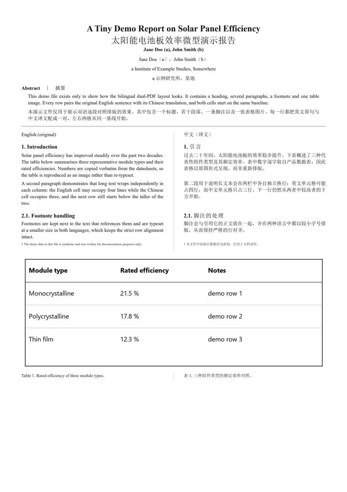

# Bilingual Dual-PDF · 双语逐段对照 PDF 生成器

> 把一个 PDF（论文 / 报告 / 说明书）变成 **左原文、右译文、一段一行严格对照** 的双语 PDF：
> 图表跨栏居中并配双语题注、脚注双语、参考文献原文照录。
> 同时产出**可编辑的 Markdown 源**，改完一条命令重出 PDF。

**English**: Turn any text-based PDF into a side-by-side bilingual PDF (original left, translation right,
strictly row-aligned per paragraph), with figures/tables reproduced at full width and bilingual captions.
Also emits an editable Markdown source. Designed for **low token cost** in LLM agent pipelines.



---

## 为什么用它

| 常见做法 | 问题 | 本项目 |
|---|---|---|
| 逐段贴进聊天窗口翻译 | 上下文爆炸、断行错乱、图表丢失 | 抽取 → 结构化 JSON → subagent 并行翻译 → 自动排版 |
| 用 LLM 直接生成 PDF | 版式靠猜、无法复现 | 固定脚本 + 固定模板，结果可复现、可回归 |
| 只给译文 | 无法对照原文核查 | 左原文右译文，**逐段顶边对齐** |
| 图表重新绘制 | 失真、耗时 | 原 PDF **矢量裁图**（288 dpi），数据零误差 |

一次 15 页双栏论文的实测：**约 8–12k tokens**（早期手工做法约 30k+），耗时 10–15 分钟。

---

## 快速开始

```bash
# 0) 依赖（Python 3.10+）
pip install pypdfium2            # 裁图 + PDF 校验
# 可选：pip install reportlab    # 无 Chrome 时的兜底渲染器

# 1) 抽取（只打印统计，不打印正文）
python scripts/extract.py --pdf paper.pdf --out work

# 2) 图表裁图（检查/微调 work/assets.json 的 bbox）
python scripts/crop_assets.py --pdf paper.pdf --work work

# 3) 翻译：切块 → 交给 3 个翻译代理 → 合并校验
python scripts/translate_chunks.py split --work work --parts 3
#    …subagent 读 work/chunkN.txt，写 work/trans_N.json…
python scripts/translate_chunks.py merge --work work

# 4) 排版：Markdown + 浏览器打印（默认，无需 TeX）
python scripts/mdgen.py  --work work --front-page 1
python scripts/md2pdf.py --md work/bilingual.md --pdf work/bilingual-md.pdf

# 5) 校验（结构 / 缺译 / 文本层 / 缩略图）
python scripts/verify.py --work work --pdf work/bilingual-md.pdf --sheet 2
```

产物：`work/bilingual.md` + `work/bilingual-md.pdf`。

### 作为 DSH / Claude Code 技能使用

```powershell
# Windows：拷进用户技能目录（DSH）或 Claude Code 技能目录
.\install.ps1                 # -> ~/.dsh/skills/bilingual-dual-pdf
.\install.ps1 -Target claude  # -> ~/.claude/skills/bilingual-dual-pdf
```

```bash
# macOS / Linux
./install.sh                  # -> ~/.dsh/skills/bilingual-dual-pdf
./install.sh --target claude
```

安装后，只要对代理说「把这个 PDF 做成中英对照」，它会自动加载本技能并按其五步流程执行
（详见 [SKILL.md](SKILL.md)）。

---

## 工作原理

```
PDF ──extract.py──► segments_en.json   （段落/标题/脚注，id 稳定）
   └─assets.json───► crop_assets.py ──► assets/*.png（图表 288dpi）
                                    │
segments + trans_N.json ──translate_chunks.py──► translations.json
                                    │
                   ┌────────────────┴─────────────────┐
          mdgen.py + md2pdf.py                 build_tex.py（可选）
          Markdown → HTML → Chrome 打印        LaTeX（Tectonic/xelatex）
                   └────────────► PDF ◄───────────────┘
                                    │
                              verify.py（机器校验 + 1~2 张缩略图）
```

- **抽取**：自研纯 Python PDF 解析（FlateDecode / ToUnicode / 内容流），自动识别双栏、标题、
  脚注（y<180 且不在图表框内）、表格块与图片落位；不依赖 PyMuPDF。
- **翻译**：按 id 切成 chunk 交给多个代理并行，JSON 交回后校验 key 覆盖，缺译会列出具体 id。
- **排版**：一行 = 一个原文段落；两列 `p{}`/`td` 天然顶边对齐，行高取较高者，分页自动。

详见 [docs/WORKFLOW.md](docs/WORKFLOW.md)；省 token 的量化对比见
[docs/TOKEN-BUDGET.md](docs/TOKEN-BUDGET.md)；踩坑记录见
[docs/TROUBLESHOOTING.md](docs/TROUBLESHOOTING.md)。

---

## 三个排版后端

| 后端 | 需要 | 适用 | 状态 |
|---|---|---|---|
| **Markdown + Chrome（默认）** | Chrome / Edge | 要可编辑源、不装 TeX | ✅ 实测 29 页 |
| LaTeX（Tectonic / xelatex） | TeX 引擎 + CJK 字体 | 出版级排版 | ⚠ 可用，但字体/路径约束多（见 docs） |
| reportlab canvas | `reportlab` | 无浏览器、无 TeX | ✅ 实测 27 页 |

## 适用范围与限制

- ✅ 文本型 PDF（Word/LaTeX 导出）、双栏或单栏、含表格/插图/脚注/参考文献
- ⚠ 扫描件（无文本层）需先 OCR，本工具不包含 OCR
- ⚠ 公式行两侧保持原文符号，不做翻译
- ⚠ 参考文献默认原文照录（不翻译）
- ⚠ 表格以**原图裁切**呈现（保留原始数据），不是重排的 HTML 表格

## 目录

```
SKILL.md                 技能入口（供 DSH / Claude Code 等加载）
scripts/                 11 个脚本：抽取/裁图/分块/排版/校验/兜底渲染/字体转换
templates/dual.tex       LaTeX 模板（一行=一个段落对）
references/              reportlab 兜底引擎
examples/demo/           合成示例（不包含任何受版权保护的原文）
docs/                    工作流 / token 预算 / 排错 / 预览图
```

## License

[MIT](LICENSE)。示例数据为原创合成内容；**本仓库不包含任何论文原文或其译文**。
