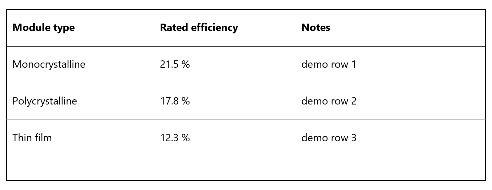

<!-- 由 bilingual-dual-pdf/mdgen.py 生成：两列表格 = 左原文 / 右译文 -->

# A Tiny Demo Report on Solar Panel Efficiency

# 太阳能电池板效率微型演示报告

**Jane Doe (a), John Smith (b)**

Jane Doe（a），John Smith（b）

a  Institute of Example Studies, Somewhere
a 示例研究所，某地

#### Abstract　｜　摘要

> This demo file exists only to show how the bilingual dual-PDF layout looks. It contains a heading, several paragraphs, a footnote and one table image. Every row pairs the original English sentence with its Chinese translation, and both cells start on the same baseline.

> 本演示文件仅用于展示双语逐段对照排版的效果。其中包含一个标题、若干段落、一条脚注以及一张表格图片。每一行都把英文原句与中文译文配成一对，左右两格从同一基线开始。

---

| English (original) | 中文（译文） |
| --- | --- |
| **1. Introduction** | **1. 引言** |
| Solar panel efficiency has improved steadily over the past two decades. The table below summarises three representative module types and their rated efficiencies. Numbers are copied verbatim from the datasheets, so the table is reproduced as an image rather than re-typeset. | 过去二十年间，太阳能电池板的效率稳步提升。下表概述了三种代表性组件类型及其额定效率。表中数字逐字取自产品数据表，因此表格以原图形式呈现，而非重新排版。 |
| A second paragraph demonstrates that long text wraps independently in each column: the English cell may occupy four lines while the Chinese cell occupies three, and the next row still starts below the taller of the two. | 第二段用于说明长文本会在两栏中各自独立换行：英文单元格可能占四行，而中文单元格只占三行，下一行仍然从两者中较高者的下方开始。 |
| **2.1. Footnote handling** | **2.1. 脚注的处理** |
| Footnotes are kept next to the text that references them and are typeset at a smaller size in both languages, which keeps the strict row alignment intact. | 脚注会与引用它的正文放在一起，并在两种语言中都以较小字号排版，从而保持严格的行对齐。 |
| 1 The demo data in this file is synthetic and was written for documentation purposes only. | 1 本文件中的演示数据均为虚构，仅用于文档说明。 |

| Table 1. Rated efficiency of three module types. | 表 1. 三种组件类型的额定效率对照。 |
